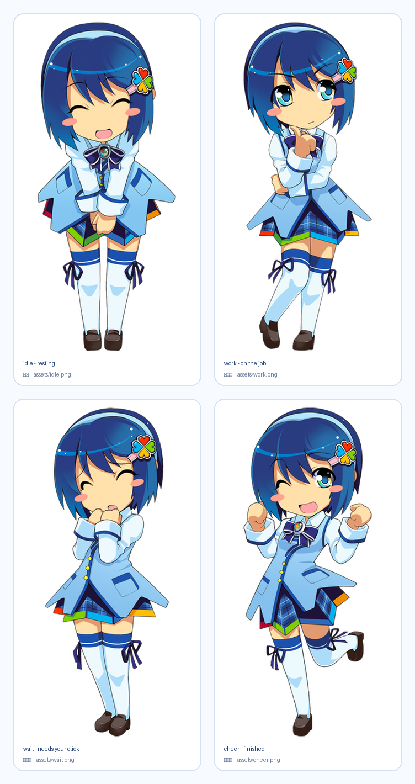

# OStan Nanami-San 🐾

**A chibi desktop companion for the DeepSeek Harness GUI — she works when you work, waits when you're the bottleneck, and cheers when the turn lands.**



*The four packed poses: `idle` (waiting), `work` (on the job), `wait` (needs your click), `cheer` (finished).*

---

## 中文简介

OStan Nanami-San（小名「奈奈酱」）是住在 DSH 窗口右下角的小桌宠：

- **四套神态**：待机、干活中（举手示意）、等你（害羞托腮）、完成（举拳欢呼），全部来自同一角色的四张参考立绘。
- **跟着真实进度动**：某一轮对话开始 → 进入「干活中」并显示进行中的会话数；正常结束 → 欢呼台词；报错 → 担心脸；需要你确认 → **强制切换为「等你」**。
- **互动**：单击摸头（+好感度）、右键菜单投喂 / 换状态 / 调大小 / 隐藏、左键拖动换位置。
- **好感度**：摸头 +2、投喂 +6，共 6 级称号（初次见面 → 命定之人），进度条实时显示在菜单里。
- **睡觉与干活共存**：长时间没互动会打瞌睡，而**干活不会叫醒她**——你点她一下才醒，并保持清醒一段时间。唯一例外是上面的「等你」。
- **安静**：`prefers-reduced-motion` 下自动关动画；贴图与文字都随框架语言切换。

---

## What it actually is

One DSH plugin package with the standard two-face shape:

| Half | File | Responsibility |
| --- | --- | --- |
| **Host** | [`lib/index.js`](lib/index.js) | Projects live turn boundaries into one pet-state snapshot and serves `/api/ostan-nanami-san/*` plus the packaged sprites at `/ostan-nanami-san-assets/*`. |
| **Web client** | [`lib/client.js`](lib/client.js) | Mounts the companion into the frame-wide `shell.overlay` seat, polls that snapshot, renders the sprite, and owns every interaction. |

She is an **in-window** companion (the same class as the shipped whale pet), not a separate OS desktop overlay.

## Staying in step with the Host

The state is **reconciled with the Host, not merely accumulated from events**. A pure event ledger drifts in two ways this code is built to avoid:

- a session **already running when the plugin mounted** is never announced, so the pet sits idle while the user's session works — the tracker adopts the live agent registry (`ctx.agents.list()`) at mount, on every config reload, and (throttled to 1 s) on every state poll, so a gap heals within one poll instead of needing a restart;
- one **missed `turn/end`** pins a session at "running" forever — reconcile drops any agent the Host no longer lists.

Three more rules keep the face honest:

- **She follows the session you are looking at.** This client face has no `sessions.list` to read the current session from, and scraping the DOM for a session marker would be fragile and forbidden — so the bundle seats a **zero-pixel probe in `conversation.chat.turnTail`**, a session-scoped slot whose standard props carry `sessionId`. The probe hands that id to the floating companion, which rides it on every poll (`/state?current=<id>`), and the Host narrows every read to that one session.
- **The menu reports the scope the Host actually used, not the one the client asked for.** The Host answers with `following`:
  - `session` — the reported id is one it has recorded, so the readings are that session's;
  - `unknown` — an id was sent that the Host has never seen (a session with no recorded turn yet). The readings in force are the Host-wide ones, and the menu says so rather than claiming a scope the numbers did not come from;
  - `host` — no session was reported at all.

  `/state?ids=1` additionally returns the tracked session ids. It exists for one caller — a human debugging scope with `curl` — and carries session identity only, never a title or message text; the ordinary poll omits it.
- **Subagents never count as the user's work.** Their turns appear in the snapshot as `subagents` for diagnosis but do not drive the pet: the user did not start them and does not watch them, so counting them makes the pet look busy while the visible session sits idle.
- **A live question outranks a running turn.** A turn blocked on the user has nothing to show, so she says "waiting for you" rather than looking busy — the *waiting* face plus a `正在等你回答…` pill. The signal is durable log truth, not a live event: `ask_user_question` **blocks the turn** inside `ctx.userQuestions` until an answer lands, so its open `tool/call` *is* the pending question and its matching `tool/result` *is* the answer. `turn/end` clears it whatever the reason, so an abort cannot leave her waiting forever.

  > This was once broken, which is worth recording: an earlier version listened for a `question/request` **session event that does not exist** in `SessionEventMap`. The handler was unreachable, so the waiting face never appeared. `tests/host.test.mjs` now asserts that an invented event type moves nothing.

## Features

- **Live state machine.** `work` while a turn runs (with a badge counting busy sessions), `wait` while a structured question is unanswered, `cheer` for six seconds after a turn completes normally, a worried face for twenty seconds after a failure, `idle` otherwise. Priority is deliberate: waiting outranks work (a blocked turn has nothing to show), then a fresh failure, then a fresh success. A user *cancellation* is neither a success nor a failure, so she never celebrates a Ctrl-C.
- **A step readout.** A quiet pill above her reports what the work is *doing* — "正在读文件…", "正在跑命令…", "正在搜代码…" — and keeps the last step for one beat after the turn lands ("上一步：正在改代码"). It names the **kind** of step and nothing else; see the boundary note below.
- **Four poses, one character.** The artwork is cut out of the four supplied reference illustrations, so a state change is a genuine change of expression rather than a tint or a wobble.
- **Affinity.** Pats (+2, 800 ms cooldown) and snacks (+6, 1.5 s cooldown) accumulate into six titled levels; the level-up announces itself in a speech bubble.
- **Drag anywhere, drop anywhere.** Position persists per browser; the pet is clamped into the viewport on resize.
- **Right-click menu.** Live-status follow vs. a manual mood override, size (84–320 px), motion pause, reset position, hide — and a 🐾 button to call her back.
- **Two languages.** The dictionary follows the frame language (`<html lang>`); switching language re-reads it live.
- **Quiet by construction.** Idle chatter is rate-limited and stays silent while the Host is busy, and reduced-motion disables the sprite animation.

## Install

The package ships prebuilt: no build step, no install scripts, no network access at runtime.

```sh
# through the Harness plugin manager (it owns the profile's package.json,
# its bundle list, and the pnpm run)
plugin_manager  action: install_bundle  target: <absolute path to this directory>

# or straight from GitHub once published
dsh plugin install github:Hrauroras/dsh-plugin-ostan-nanami-san
```

On this Windows desktop install it landed in the **`desktop`** profile (the one the app actually boots — `$env:DSH_PROFILE` is the authority, not a guess):

```json
"dependencies": { "dsh-plugin-ostan-nanami-san": "link:C:/Users/A2178/Downloads/dsh-plugin-ostan-nanami-san" },
"dsh": { "profile": { "bundles": ["...", "dsh-plugin-ostan-nanami-san"] } }
```

The `link:` spec installs a junction, so a source edit here reaches the running Host on the next page load; only the Host half needs a DSH restart to re-import.

Confirm it is live:

```sh
curl 'http://127.0.0.1:19387/api/ostan-nanami-san/health'
# {"ok":true,"version":"0.6.0","sessions":1}
```

> Already running a whale companion? Both can live in the same frame; she seats herself at `order: 88`, the whale pet at `order: 90`.

## Usage

| Gesture | Effect |
| --- | --- |
| Click | Pat her head (affinity +2) |
| Drag | Move her; the spot sticks |
| Right-click | Menu: pat, snack, mood override, size, motion, reset, hide |
| Click the badge area | — (the badge counts sessions currently working) |

## Privacy and runtime boundaries

- Reads **turn, question and tool boundaries only** — session id, event sequence, and a tool's *name*. No message text, no tool arguments, no file contents, no history, no model calls.
- No telemetry, no external requests, no additional listening port, no model calls, no approval handling.
- Sprite bytes are served from the package via an allowlist (`idle|work|wait|cheer` + `.png`); no caller-supplied path ever reaches the disk.
- Sprite responses revalidate (`no-cache, must-revalidate`) against a **content-hash ETag**, never the filename: a redrawn pose must reach a browser that already holds the old one. The client additionally stamps the URL with `ASSET_VERSION`, which is the only lever that reaches a browser already caching under an older policy.
- **The poll never pauses on visibility.** An earlier version gated `start()` on `document.visibilityState === 'visible'`, so a frame that did not report visible at mount never polled at all — and since `visibilitychange` only fires on a *change*, nothing could rescue it. The symptom was "she only updates when I click her", because the click forced a re-render over a stale snapshot. The interval now opens unconditionally, a 5 s watchdog reconciles it, and a session switch re-reads immediately even while the document reports itself hidden.
- Affinity, treats, size, position and visibility stay in the browser's `localStorage` under `ostan-nanami-san:*`.
- The host keeps a bounded in-memory projection (max 512 sessions); nothing is written to disk.

## Development

```sh
node --test tests/host.test.mjs tests/client.test.mjs tests/routes.test.mjs   # 81 tests
python tools/make_sprites.py                                                  # re-cut sprites from sources
python tools/make_preview.py                                                  # regenerate docs/poses.png
node tools/trace-state.mjs 40 400                                             # sample the live snapshot
node tools/simulate-poll.mjs <sessionId> 12                                   # replay one tab's poll
```

To see what a given scope actually answers, ask the Host directly — this is also how the scope rules were verified against a real session rather than a guessed id:

```sh
curl 'http://127.0.0.1:19387/api/ostan-nanami-san/state?ids=1'                       # tracked session ids
curl 'http://127.0.0.1:19387/api/ostan-nanami-san/state?current=<id>'               # that session only
curl 'http://127.0.0.1:19387/api/ostan-nanami-san/state?current=ghost'              # following=unknown
```

`tools/make_sprites.py` re-derives `assets/*.png` from the original reference illustrations. **Bump `ASSET_VERSION` in `lib/client.js` after any re-cut**, or a browser holding an older sprite keeps showing it.

The cut-out is a **border flood fill, not a colour threshold**. The character is drawn with large white areas — blouse, collar, sleeves, both thigh-high socks — enclosed by dark line art, so a global "distance from white" test punches them out as holes. Paper white is only the region connected to the image border, so the script fills from the frame and leaves every enclosed white pixel opaque. `tools/diagnose_visual.py` renders the mask next to the cut-out over magenta for exactly this check, and `tools/diagnose_alpha.py` reports how much of the sheet the fill swallowed (a leaking fill takes most of it). The build output prints the count of kept bright pixels — it is `0` for a threshold-style cut and several thousand for a correct one.

`tests/client.test.mjs` renders the real component against a small React double whose hooks actually work: `useState` re-renders, `useCallback` memoizes on its dependency array, and effects flush after the commit and re-run only when their deps changed. Those three semantics are what make a state-setting effect observable instead of an infinite loop.

The tests cover the boundary projection (including hostile input), the route contract (including path traversal, oversize bodies and conditional requests), and the client half end to end — module id, `apply`/`inject` shape, a Host with no `shell.overlay` seat, and one assertion per rendered state (idle/work/wait/error/cheer), plus pat, drag, feed, menu, size bounds, hide-and-summon, both dictionaries and the step pill. Two of them are privacy assertions: the tool-call arguments used in the fixtures must not appear anywhere in the state payload, and a subagent's step must never become the user-visible status.

One is a **hook-order guard**: the hook count must be identical in the hidden and visible renders. That is not a style preference. An early `return` in the hidden branch once sat above several hooks, so hiding her made React see fewer hooks on the next render and throw **#321, "Invalid hook call"**. The symptom was maddening — the poll kept running (its effects were still alive), the picture stayed frozen on the last good render, and a click or a page refresh "fixed" it until the next hide. The fix is structural: the hidden state is a value chosen at the end of a render, never an exit taken in the middle. Any early return added here must stay above every hook.

### When something does break

The companion is wrapped in an error boundary, and that boundary **renders the failure text on screen** rather than only logging it. A frozen picture with a live poll is nearly undiagnosable from the outside; a visible `⚠ 奈奈酱出错了` with a stack is not. The right-click menu carries the same idea in miniature — `轮询 / 应用 / 渲染` counters that separate "the poll died" from "the request failed" from "the state updated but the render did not happen".

**The boundary must receive an element, never a call.** An earlier version read

```js
render() { return this.props.render() }   // WRONG — #321 "Invalid hook call"
```

which ran the companion's hooks outside React's render context. Two lessons are baked into the tests now:

- the harness cannot enforce hook context, so it asserts the **shape** instead: the boundary's child must be an element with an element type, never the result of calling a component;
- a hand-rolled double is a tool with blind spots, and passing it is not evidence. It stayed green through this bug. That is why the error is also rendered where a human can read it, and why the framework's own verdict beats the harness's.

### Sleeping and working coexist — the question is the one exception

By request: a busy Host does **not** wake her. She naps through a long run, and the user wakes her by interacting — that poke sets `awakeUntil`, which is also what keeps her from dozing off again on the next tick. Because sleeping and working now genuinely coexist, the idle-chatter line is allowed during a run too: a sleeping companion muttering "Zzz…" no longer contradicts the pose she is wearing.

The one thing that always wins is a **question waiting on the human**:

```js
if (status === 'waiting') mood = 'wait'          // outranks sleep AND a manual mood
else if (forced !== 'follow') mood = forced
else if (snapshot === null || snapshot.ok === false) mood = 'idle'
else if (!awake) mood = 'sleep'
else mood = statusMood[status] ?? 'idle'
```

She comes out of a deep sleep to ask, and stays awake afterwards rather than dropping straight back down once answered. That wake-up lives in an **effect, never in the render body**: writing to the store while rendering schedules another render, and that render fires another poll — a side effect that has no business in a render, and one that made a test read an offline posture instead of the snapshot it had just published.

This ordering was arrived at by getting it wrong twice in opposite directions: first the nap outranked work (so work was invisible until the user clicked), then work outranked the nap (so she never slept through a run). Both were the same mistake — deciding the priority order without asking which state the user actually wants to see.

### Where the step readout draws its line

The pill answers "what kind of step is running" and stops there. It reads the `name` field of a `tool/call` session event and maps it through `TOOL_LABELS`; the event's `arguments` are model output and never enter the projection, the snapshot, or the browser — a tool the map does not know falls back to its raw wire name rather than guessing at meaning. No message text, no file contents, no command lines, no reply snippets. That is why the pill says "正在跑命令…" and never what the command was.

`tools/asar_tool.py` and `tools/asar_grep.py` read DSH's own `app.asar` (list, extract, regex-grep) — that is how the plugin contract in this package was checked against the shipped implementation rather than guessed.

## Artwork notice

The four poses are derived from reference illustrations supplied by the plugin's owner for this personal companion. **The character is not original to this project.** The artwork is therefore **not** covered by the MIT license of the code: it is included for personal use and demonstration only, and must not be used commercially or redistributed for profit. If you intend to publish this for a wider audience, satisfy yourself about the source and licensing of the reference illustrations first.

## License

Code: MIT, see [LICENSE](LICENSE). Artwork: personal use only, see the notice above.
